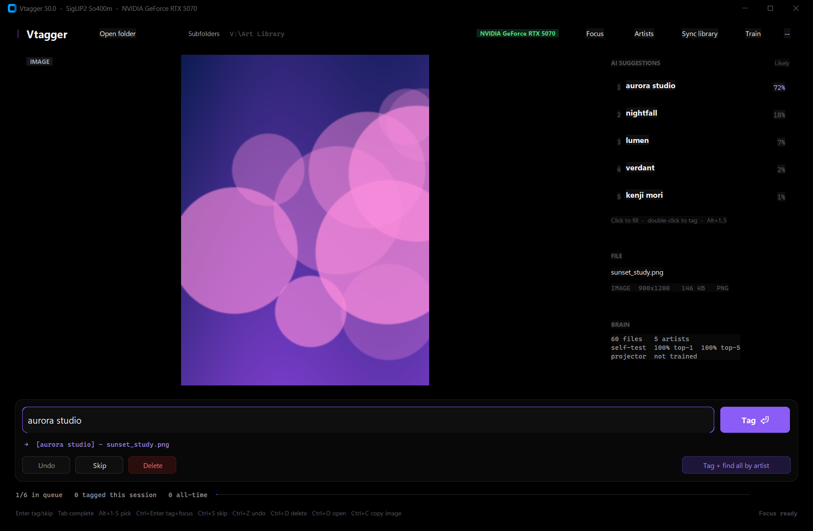

# Vtagger

**A local, GPU-accelerated artist tagger that learns your library.**



Vtagger renames your images and videos to `[artist] - original name`. It learns every artist's style from the files you've already tagged, suggests the artist for each new file, and can find every file by one artist in your untagged pile in seconds. It runs entirely on your own machine, and every tag and every rejection makes it better.

---

## Why Vtagger

- **It learns *your* artists.** Public models only know famous artists. Vtagger learns from your own `[artist] - ...` files, so it recognises anyone you've tagged, even artists nobody else has heard of.
- **Fast enough to tag thousands in a sitting.** Type a few letters, press Enter, and the next file is already on screen. Renaming and learning happen in the background.
- **Focus mode.** Pick an artist and Vtagger trains a dedicated detector for them in about a second, then ranks your whole queue by how likely each file is theirs.
- **Confidence you can trust.** Percentages are calibrated on files the model never trained on, so 80% means it's right about 80% of the time.
- **Images and videos.** Videos are judged from frames sampled from the clip.
- **Remembers files, not filenames.** Each file is identified by a fingerprint of its content, so renaming or moving files never loses what it learned.
- **Built for huge libraries.** Developed on a 300,000-file library. Every file is analysed once and stored, so after the first pass, scans of tens of thousands of files take seconds.
- **Clean OLED-black interface.**

## How it works

| Part | What it does |
|---|---|
| **Vision model** | [SigLIP2 So400m](https://huggingface.co/google/siglip2-so400m-patch14-384) at 384px, fp16 on CUDA with CUDA graphs. WD-EVA02-Large, a combined WD + SigLIP2 mode and ConvNeXt can be chosen in Settings. |
| **Suggestions** | Every labelled file is kept as an embedding in one GPU matrix. A new file is compared against all of them and its closest matches vote, weighted by similarity. Files you've rejected for an artist are excluded. |
| **Train** | Optionally learns a style projection on your library that pulls each artist's files together. It's kept only if it measurably improves accuracy on held-out files. |
| **Focus** | Trains a per-artist detector: a linear probe (this artist vs. everyone else, with your rejections as hard negatives) combined with a nearest-neighbour margin, then calibrated on held-out files. |
| **Calibration** | A leave-one-out pass over your library turns raw scores into honest probabilities. |

## Requirements

- **Windows 10/11.** Other platforms may work but are untested. Recycle Bin, clipboard and taskbar progress are Windows features.
- **Python 3.10 or newer**, from [python.org](https://www.python.org/downloads/). Tick "Add Python to PATH" when installing.
- **An NVIDIA GPU** is strongly recommended. Without one it runs on the CPU, but much more slowly.
- **Disk:** about 8 GB for the model and libraries, plus about 6 KB per file in your library.

## Install

### Option A: Windows app (no Python needed)

1. Download `Vtagger-v50-windows-x64.7z` from the [latest release](https://github.com/visiuun/vtagger/releases/latest).
2. Extract it with [7-Zip](https://www.7-zip.org/) (about 3.7 GB unpacked).
3. Run `Vtagger.exe` inside the `Vtagger` folder.

PyTorch with CUDA is included. On first launch the vision model (about 4.5 GB) downloads automatically. You need an NVIDIA GPU with a recent driver for full speed.

### Option B: Run from source

```bash
git clone https://github.com/visiuun/vtagger.git
cd vtagger
python vtagger.py
```

That's it. **Everything installs automatically on the first launch:**

1. Missing Python packages (CustomTkinter, Pillow, NumPy, OpenCV, timm, transformers and others).
2. PyTorch: the CUDA build if you have an NVIDIA GPU, otherwise the CPU build.
3. The vision model, about 4.5 GB, downloaded from Hugging Face.

The first launch takes a few minutes. After that the app starts in seconds.

No git? Click **Code → Download ZIP** on GitHub, unzip it, and run `python vtagger.py` in that folder.

To install the dependencies yourself, see [`requirements.txt`](requirements.txt). Get PyTorch from [pytorch.org](https://pytorch.org/get-started/locally/).

## Getting started

### 1. Open your folder
Click **Open folder** (or press `Ctrl+O`) and pick the folder containing your images and videos. Vtagger remembers it for next time. To include subfolders in the tagging queue, turn on the **Subfolders** switch in the top bar.

### 2. Sync your library
Click **Sync library**. Vtagger reads every file already named `[artist] - something` and learns each artist's style from it (Sync always includes subfolders). This is the only slow step: every file is analysed once, at roughly 50 files per second on a modern NVIDIA GPU. It saves as it goes, so you can cancel at any time and pick up later without losing progress.

> **Naming format:** `[artist] - original name.ext`. For several artists: `[artist one, artist two] - name.ext`.

### 3. Tag
Untagged files are shown one at a time, with the top suggestions next to the preview.

- **Type an artist's name.** Autocomplete shows the rest in grey and lists matches above the box, with the artists you use most at the top.
- **Press Enter** to tag. The file is renamed, the box clears, and the next file appears immediately.
- If a suggestion is right, press **Tab** on an empty box to take the top suggestion, or **Alt+1 to Alt+5** to pick one, then press Enter.
- For several artists, separate them with a comma: `artist one, artist two`. Autocomplete works on each name.

Every tag teaches the model, so suggestions get better as you go.

### 4. Focus: find everything by one artist
Click **Focus**, type an artist, and start the scan. Vtagger trains a detector for that artist and ranks every untagged file by confidence.

- **✓ Tag** tags a file. **✕** rejects it: the detector learns from rejections and won't suggest that file, or near-copies of it, for that artist again.
- **The confidence slider** controls what's shown. Lower it to find more of the artist's files; raise it for fewer mistakes.
- **Tag all shown** tags everything at or above the slider in one go.
- **Step through** goes through the candidates one by one in the main view.
- Press **Ctrl+Enter** while tagging (or click **Tag + find all by artist**) to tag a file and immediately search for the rest of that artist's files.

While you work, Vtagger quietly prepares your untagged files in the background. The footer shows **Preparing Focus** and then **Focus ready**. After that, Focus scans take a few seconds even on huge folders.

### 5. Train (optional)
Once you have a few thousand tagged files, click **Train**. Vtagger learns a style projection tuned to your library and keeps it only if it improves accuracy.

## Keyboard shortcuts

| Key | Action |
|---|---|
| `Enter` | Tag the current file |
| `Ctrl+Enter` | Tag, then find all files by that artist |
| `Tab` / `→` | Accept the autocomplete (or the top suggestion when the box is empty) |
| `↑` / `↓` | Move through the autocomplete list |
| `Esc` | Close the list, then clear the box |
| `Alt+1` to `Alt+5` | Use suggestion 1 to 5 |
| `Ctrl+S` | Skip file |
| `Ctrl+Z` | Undo last tag |
| `Ctrl+D` | Delete file (to the Recycle Bin) |
| `Ctrl+O` | Open folder |
| `Ctrl+C` | Copy the image to the clipboard |

## More tools

- **Artists:** browse every artist with file counts; rename, merge, untag or delete artists; find spelling duplicates (like `Artist_Name` vs `artist name`) and merge them in one click.
- **⋯ menu:** Settings (vision model, batch size and more), rescan the folder, recalibrate confidence, open the data folder.
- **Right-click the preview** to open the file, show it in Explorer, or copy the image or its path.

## Your data

Everything stays on your computer. Vtagger keeps its database (file fingerprints, embeddings, your tags and rejections), settings and logs in `%APPDATA%\Vtagger`. Deleting that folder resets it completely. Your files are only ever renamed, never modified, and deletes go to the Recycle Bin.

## Troubleshooting

- **It's slow or using the CPU:** check that `nvidia-smi` works in a terminal and that your NVIDIA driver is up to date. Then delete `%APPDATA%\Vtagger\.cuda_ok` and restart; Vtagger will check and reinstall CUDA PyTorch if needed.
- **The first launch looks stuck:** it's probably downloading PyTorch (about 3 GB) or the model (about 4.5 GB). Watch the console window.
- **Something went wrong:** see `%APPDATA%\Vtagger\vtagger.log`.

## License

[MIT](LICENSE) © visiuun
